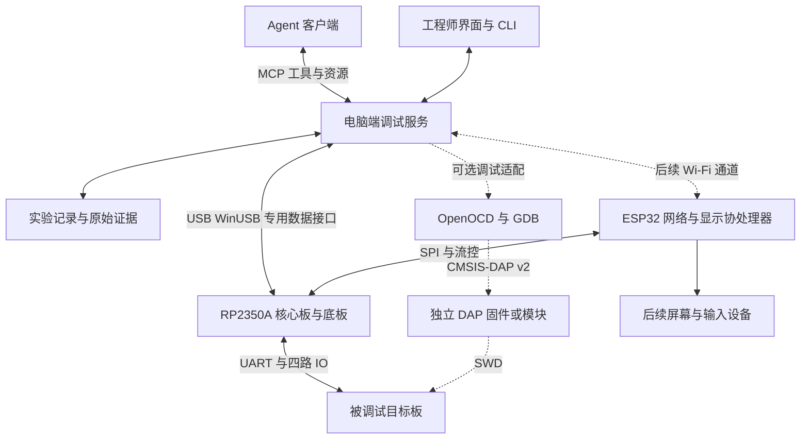

# 面向 Agent 的嵌入式调试工具项目立项报告

版本：V0.4  
日期：2026年11月6日  
项目性质：个人 DIY 研发项目  
立项阶段：技术预研与首版原型规划

## 1 立项结论

建议立项，先完成能够接入 Agent 的有线调试原型，再增加无线访问和本地屏幕。项目面向嵌入式软件开发工程师，以串口日志、四路逻辑采集和实验控制为常规能力，并通过电脑端服务将这些能力转换为 Agent 可调用、结果可追溯的工具。CMSIS-DAP v2 为附加能力，常规工况不开启，可采用独立固件或独立硬件模块，不作为常规 USB 接口和首版闭环的前置条件。

项目要验证的核心价值是：Agent 能在工程师授权范围内配置实验、取得真实设备证据、关联代码与运行现象，并在修改后重复同一实验。硬件采集、确定性协议处理和数据分析由固件与主机软件完成，模型负责提出假设、选择工具和解释结果。大模型运行于电脑端或用户选择的服务，首版不在 MCU 上运行大模型。

建议首版以 USB 为主通道，使用现有正点原子 RP2350A 核心板设计底板。四路采集与片间 SPI 分别占用独立引脚。协处理器已确定为 ESP32-S3，负责后续无线接入和屏幕。首次 Agent 闭环验证使用有线链路。

本报告中的性能、工时和验收数字均为建议目标或计算结果，尚无本项目整机实测结果。立项采用阶段验收，性能不达标时调整指标或数据路径，不用器件理论峰值替代整机验证。

## 2 项目背景与使用问题

嵌入式调试通常需要在源码、串口终端、逻辑分析仪、调试器和测试脚本之间切换。工程师既要解释现象，也要手动配置工具、截取窗口、保存数据和重复实验。Agent 可以阅读代码、生成测试脚本和分析文本，但如果无法访问目标设备，就缺少检验代码行为的直接证据。

本项目将设备的日志、逻辑时序和调试状态接入同一台主机服务，让 Agent 能按明确参数发起实验并读取结果。主要使用场景包括启动异常、串口命令响应失败、GPIO 握手超时、I²C 或 SPI 事务异常，以及修改固件后的重复验证。

预期收益是减少人工搬运证据和重复配置的工作，并提高实验的可复现性。是否缩短故障定位时间，需要通过固定故障集与人工流程对照测量；立项阶段不承诺准确率或效率提升比例。

## 3 产品定位与研发范围

产品定位为面向 Agent 的桌面嵌入式调试工具，由调试硬件、固件、电脑端服务和 Agent 接口共同组成。常规固件负责日志与逻辑采集，工程师可通过命令行和可视化界面使用；IDE 调试和 SWD 烧录按需通过附加 DAP 固件、独立模块或已有外部调试器接入。

| 阶段 | 交付范围 | 验收重点 |
| --- | --- | --- |
| 首版闭环 | 四路逻辑采集、两路串口抓取、专用 USB 数据接口、电脑端服务、MCP 接口 | Agent 能完成配置、采集、分析和复测 |
| 无线迭代 | ESP-IDF 协处理器、配网、数据转发、断线恢复 | 无线抖动不破坏证据完整性 |
| 交互迭代 | 屏幕、按键或触摸、状态和波形概览 | 本地操作与远程控制权限一致 |
| 可选 DAP 扩展 | CMSIS-DAP v2 独立固件或独立硬件模块 | 单独验证 SWD 与目标适配，不阻塞常规固件 |
| 后续扩展 | 更多通道、更深缓存、协议解码和自动化测试库 | 根据真实瓶颈决定硬件升级 |

首版选择至少一款明确型号的目标板作为测试载体，串口与数字 IO 观测不限定目标 CPU 架构。可选 DAP 扩展先适配一款 Arm Cortex-M 目标，仅支持经过测试的目标配置、烧写算法和调试工具版本，不以 CMSIS-DAP 协议支持推导全部芯片兼容性。CMSIS-DAP v2、JTAG、SWO、通用拖拽烧录、模拟示波器、可调逻辑阈值和高采样率无限连续上传均不纳入首版常规固件验收。

两路串口先以 RX 监听为基础能力。TX 和目标复位属于按需配置的主动控制动作；暂停、寄存器快照和 SWD 烧录依赖可选 DAP 或已有外部调试器。所有主动动作均需要明确目标连接及授权范围。首版支持共地的 3.3 V 逻辑系统，其他电压和隔离接口通过独立前端设计后扩展。

## 4 典型 Agent 调试闭环

以“设备收到命令后未拉高 READY”为示例，使用流程如下。

1. 工程师提供预期行为、目标板配置和相关代码路径，选择允许的调试动作。
2. Agent 读取设备能力、固件版本和当前连接状态，确认串口与四路采集通道定义。
3. Agent 配置触发、采样率、窗口和串口抓取，然后执行已登记的测试步骤。
4. 本地服务返回任务编号；采集完成后返回数据完整性、事件摘要和原始证据引用。
5. Agent 读取指定时间窗口，关联日志、GPIO 边沿和源码，给出有证据支持的判断及仍未排除的解释。
6. 修改由工程师确认或交给既有代码开发流程；需要烧录时，通过已有下载流程或可选 DAP 执行已授权、已核验的镜像。
7. 使用相同测试配置复测，保存修改前后的证据及差异。

验收时不能仅展示模型生成了一段分析。必须保留实际工具调用、设备返回结果和原始数据，并能在不调用模型的情况下重复执行同一个测试步骤。

## 5 系统架构

电脑端服务负责设备发现、连接管理、实验编排、数据持久化、协议解码和访问控制。MCP 是 Agent 接入适配层；同一业务能力也提供 CLI 或本地 API，以便人工操作、脚本回归和故障排查。MCP 的工具参数、结构化结果和资源引用可作为实现基础，但具体能力须按实际客户端验证。[R5]

RP2350 常规固件负责 PIO 采集、UART 接收、时间基准、触发、缓存和专用 USB 协议。ESP32 负责网络协议栈和后续界面。底层固件不依赖模型生成实时波形。图中的 DAP 是可选逻辑能力，若采用同一 RP2350 的独立固件，则需切换固件运行，不代表额外硬件或与采集同时工作；若需要同时工作，优先使用独立 DAP 模块或外部调试器。

电脑端服务建立设备锁、采集锁与目标控制锁。接入外部调试器或 DAP 扩展时，也必须协调 IDE 与 Agent 对同一目标的主动控制。暂停或复位目标会改变被观测系统，必须作为实验事件记录，并允许工程师选择完全被动的采集模式。

## 6 首版硬件方案

### 6.1 已确认的硬件基线

| 项目 | 当前决策 | 备注 |
| --- | --- | --- |
| 主控载体 | 正点原子 RP2350A 小系统板 | 第一版设计配套底板 |
| 逻辑采集 | 四路 | GP16 至 GP19 |
| 片间接口 | 独立四线 SPI | GP20 至 GP23，RP2350 为主机 |
| 常规 USB | 厂商自定义接口与 WinUSB | 日志、采集、配置及状态通过同一业务协议分帧 |
| CMSIS-DAP v2 | 附加能力，常规工况不开启 | 独立固件或独立模块，具体实现形式待定 |
| 无线协处理器 | ESP32-S3 | 已确认芯片系列，模组后缀及 Flash、PSRAM 容量待定 |
| 软件框架 | RP2350 使用 Pico SDK 2.3.1，ESP32-S3 使用 ESP-IDF 6.1.0 | 两套固件独立构建 |
| 屏幕 | 后续迭代 | 暂不固定尺寸、控制器和引脚 |

核心板官方资料提供原生 USB 与 USB 转串口两个接口。常规固件通过原生 USB 提供 Agent 数据通道，板载 CH343 通道可用于开发期固件诊断，不能替代原生 USB 的免驱验收。核心板的原生 SWD 是 RP2350 自身调试入口；若采用独立 DAP 固件，对外目标 SWD 需另行使用普通 GPIO 及专用前端实现。[R1]

### 6.2 首版引脚与电路约束

| RP2350 GPIO | 底板功能 | 状态 |
| --- | --- | --- |
| GP16 GP17 GP18 GP19 | CH0 CH1 CH2 CH3 逻辑采集 | 已确定功能分组 |
| GP20 | SPI0 RX 接 ESP32 MISO | 已确定 |
| GP21 | SPI0 CSn 接 ESP32 CS | 已确定 |
| GP22 | SPI0 SCK 接 ESP32 SCLK | 已确定 |
| GP23 | SPI0 TX 接 ESP32 MOSI | 已确定 |
| 其他 GPIO | UART 握手 复位 电压检测和使能 | 原理图核对后分配；对外 SWD 按可选方案预留 |

SPI 映射符合 RP2350 复用表。[R2] 用户提供的引脚表显示 GP16 至 GP23 独立引出，但尚未完成连接器焊盘、核心板版本和完整电路核对。GPIO27 至 GPIO29 的 ADC 行存在重复命名，不能直接生成最终网表。LCD、TF 卡和 CH343 的关联 GPIO 必须核对现有负载，不能仅关闭软件功能就认定电气隔离。[L1]

按现有引脚表，QSPI 总线未引出。首版底板不能直接按 QMI 第二片选方案增加采集 PSRAM；高速窗口首先采用片内 SRAM。ESP32 的 PSRAM 只能缓冲已通过 SPI 搬运的数据，无法替代采集侧带宽。[L1]

底板需要输入保护、电平转换、目标参考电压检测和默认关闭的目标输出。SWDIO 方向控制及目标 SWD 接口属于可选 DAP 电路，可预留不装或交由独立模块实现。ESP32 采用独立供电支路，核心板与底板供电路径要防止两个 USB 或外部电源互相回灌。确认 RP2350 stepping，并按对应勘误处理输入行为；A4 已修复早期 E9 GPIO 漏电问题。[R3]

### 6.3 ESP32-S3 协处理器

ESP32-S3 提供 2.4 GHz Wi-Fi 和两路通用 SPI。底板可考虑用 SPI2 作 RP2350 片间从机，SPI3 留给后续屏幕。投板前按具体模组后缀核对可用 GPIO、Flash 和 PSRAM，确定 S3 侧引脚。[R7]

### 6.4 常规 USB 与可选固件

常规固件默认提供单个厂商自定义 USB 接口，使用一对 Bulk IN 与 Bulk OUT 端点。命令、应答、设备状态、两路 UART 日志和四路逻辑数据通过消息类型、通道号、请求编号、序号和长度区分；接收端按协议重组消息，不把主机一次读取或一个 USB 包当作完整业务帧。控制与数据分别排队，大块上传分块执行，避免控制响应长期饥饿。

Windows 10/11 为首版免驱目标。固件通过 Microsoft OS 描述符声明 WINUSB Compatible ID 和设备接口 GUID，使系统自动加载内置 WinUSB；优先采用 Microsoft OS 2.0 描述符。电脑端服务调用用户态 USB 接口，Agent 通过本地服务访问。免驱指无需手动安装设备驱动，电脑端服务仍需由用户运行。可按传统串口终端兼容需求增加 CDC ACM，届时设备变为复合设备，CDC 不作为当前必备功能。[R9]

常规固件不枚举 CMSIS-DAP 接口。若采用同一主控的独立 DAP 固件，切换过程包含保存当前证据、结束采集、更新固件和 USB 重新枚举。建议常规固件与 DAP 固件使用不同 PID，具体 VID/PID 来源另行确认；主机通过序列号和能力信息重新识别当前模式，不能把已断开的采集会话继续当作有效。若采用独立硬件模块，DAP 与采集设备分别枚举和维护连接。CMSIS-DAP v2 的附加实现可参考 debugprobe 与 OpenOCD。[R4]

## 7 性能预算与技术边界

建议先验证四路 10 MS/s，再以 25 MS/s 作为首版进阶目标；50 MS/s 为探索项。采样率不是可准确测量的最高信号频率，边沿判定误差、探线质量、输入前端和有效采样比例需要用已知码型验证。

以下采用四路每点 4 bit 紧凑打包，并以 256 KiB 缓存示例计算。实际固件若按每点 8 bit 存储，容量利用率和记录时长会减半；缓存分配也须在固件链接和运行后确认。

| 采样率 | 四路原始数据率 | 256 KiB 理论记录时长 |
| --- | --- | --- |
| 1 MS/s | 0.5 MB/s | 约 524 ms |
| 5 MS/s | 2.5 MB/s | 约 105 ms |
| 10 MS/s | 5 MB/s | 约 52.4 ms |
| 25 MS/s | 12.5 MB/s | 约 21.0 ms |

RP2350 原生 USB 为全速 12 Mbit/s，实际有效负载更低。普通单线 SPI 在 20 MHz、40 MHz 时，单方向原始带宽分别为 2.5 MB/s、5 MB/s；握手、包头和事务间隔还会降低有效带宽。因此高速逻辑数据采用本地触发采集后上传，低速连续模式另行验证，不能宣称高速无限连续上传。[R2]

S3 官方 TCP 发送测试在实验室开放环境与屏蔽箱中分别给出约 20 Mbit/s 和 83 Mbit/s。建议先以端到端 2 MB/s 为优化验收目标，并在片间 SPI、网络和屏幕并发的条件下测量整机表现。[R8]

当前实际目标为项目发起者使用的 RK3566 板卡，串口波特率为 100000 baud，预计常规使用基本不超过此档。按 8N1、连续接收估算，单路有效数据约 10 KB/s，两路同时接收约 20 KB/s，未计业务协议开销；实际数据位、校验位、停止位和 IO 电压在目标板连接前确认。该工况的 USB 带宽余量充足，研发优先保证启动日志捕获、突发缓冲、数据完整性和时间关联。高于此档的波特率支持可保留，但不作为当前必需指标；原先各 1 Mbaud 的测试降为可选压力测试。

## 8 时间关联与证据模型

每次实验生成唯一 experiment_id，并记录设备序列号、板卡配置、工具与固件版本、目标固件哈希、ELF 哈希、通道定义和采集配置。原始日志、采样数据、协议解码及摘要分别保存，所有派生结论能回溯到原始片段。

波形以设备端采样起点、实际采样周期、触发索引和有效样本数描述。记录截断、PIO FIFO 停顿、DMA 溢出和数据丢失；异常区间不得呈现为连续有效波形。跨设备重启使用不同 boot_id，不把重启前后时间直接拼接。

串口 DMA 块完成时间只作为块级时间标记，并不等于每个字节的精确到达时间。结果必须提供 timestamp_kind 与误差范围或未知标记。需要精确关联时，可占用一路逻辑通道同时采样 UART RX，再在相同采样轴上解码。主机到达时间、无线传输时间和设备事件时间分开保存。

接入可选调试器时，暂停命令的发起时间与目标真正停止的时刻也不同。Agent 可以报告可确认的先后关系，精度不足时必须保留不确定性，避免把传输或软件处理延迟当作目标时序。

## 9 Agent 接口方案

### 9.1 首版接入方式

电脑端本地服务承接所有硬件访问，MCP Server 首先通过 stdio 连接支持 MCP 的 Agent 客户端。这样可避免让 MCU 直接维护模型服务认证，也便于继续使用已有 IDE 和测试脚本。不同 Agent 客户端的能力、资源读取方式和权限交互需建立兼容性记录。

下面是拟议的业务工具名称，并非 MCP 协议新增方法。MCP 层通过标准 tools/list 与 tools/call 暴露业务工具；参数和返回结果应定义 JSON Schema。[R5]

| 拟议工具 | 关键参数或返回结果 | 用途 |
| --- | --- | --- |
| device_list | device_id capabilities firmware_version | 查询真实设备能力 |
| session_open | device_id target_profile lease | 建立控制会话并取得锁 |
| log_query | session_id cursor limit filter | 有界读取日志与缺口信息 |
| capture_start | channels rate count trigger pretrigger | 发起采集并返回 task_id |
| task_get 或 task_cancel | task_id state progress error | 查询或取消长任务 |
| capture_read | capture_id window max_points | 读取摘要与指定数据窗口 |
| test_run | registered_test_id parameters | 执行已登记的测试流程 |
| evidence_export | experiment_id format | 导出可复现记录与证据 |

debug_snapshot、flash_prepare 与 flash_execute 作为可选调试适配工具，仅在独立 DAP 模块、外部调试器或对应固件模式实际可用时暴露。常规采集设备不得报告虚假的 SWD 能力；仅连接采集设备时，Agent 仍能完成日志、波形与证据分析闭环。

长时间采集和测试采用应用层任务编号及状态查询，首版不依赖所有客户端支持某一新增异步协议特性。调用具备超时、取消、限流、目标锁和明确状态机。烧录等有副作用操作不做无条件自动重试，超时后先核对设备状态。

### 9.2 返回数据的设计

模型首先取得结构化摘要，包括 status、experiment_id、数据有效性、时间范围、通道、异常事件和证据引用。原始百万点波形保存到本地，以资源引用、分页窗口和绘图摘要按需读取，避免直接塞入模型上下文。

协议解析、边沿统计、CRC、频率和脉宽测量由确定性代码完成；模型基于这些结果与原始证据解释原因。解析器需附带版本、配置、错误和不确定区间。无法解码的数据仍保留原始采样，不能被摘要吞掉。

Agent 的源码上下文来自用户授权的工程工作区；本服务只交换必要的构建标识、符号和地址映射。首版不把任意 Shell、任意 GDB 命令和无限制内存访问直接暴露为通用工具。

### 9.3 操作权限与边界

被动日志读取与主动控制分别授权。配置采集可以在会话范围内放行；UART 发送、暂停、复位和烧录通过明确能力及策略放行。授权可绑定目标、镜像哈希、动作类别、次数和有效期，减少重复确认，同时保留工程师撤销和停止实验的能力。

调试寄存器或内存的读取也可能改变设备状态，例如清除型状态寄存器。首版按目标配置限制地址范围和可用快照，无法确认的读取视为可能有副作用。解锁、读保护变化、OTP、选项字节和批量擦除不纳入自动操作范围。

设备日志、串口内容和目标返回字符串属于不可信数据。即使其中出现要求调用工具、读取文件或发送数据的文字，也只能作为被观测内容，不能改变工具权限。MCP 的工具注解本身不构成访问授权，服务端必须执行实际校验。[R5]

默认本地落盘；Agent 是否将日志、源码片段或证据发送到外部模型由用户的客户端和数据策略决定。无线迭代增加设备配对、身份认证和会话控制，不把原始调试端口直接暴露到公共网络。

## 10 MVP 验收与评估方法

| 验收项 | 建议目标 | 测试方法 |
| --- | --- | --- |
| 串口完整性 | RK3566 实际 100000 baud 工况与两路同档并发连续 1 小时无未报告丢失 | 实板启动日志复测，另用已知字节序列 CRC 与计数对照 |
| 四路采集 | 10 MS/s 基线通过，25 MS/s 进阶验证 | 独立码型源检查样本计数 边沿与触发位置 |
| 异常检测 | 溢出 断连 截断均有显式状态 | 故意限制主机消费及拔插设备 |
| Windows 免驱 | 未配置过设备的 Windows 10/11 断网首次插入可自动绑定 WinUSB | 不使用 Zadig 或自定义 INF，普通用户启动服务验证读写 |
| Agent 闭环 | 预置 5 类故障，每类重复 3 次 | 自动配置 采集 引用证据并复测 |
| 操作可追溯 | 每次实验具备配置 哈希 原始数据和调用记录 | 随机抽取记录独立回放 |
| 访问控制 | 错误设备 非法参数及未授权主动动作均被拒绝 | 无实际目标副作用的拒绝测试 |
| 并发与恢复 | 日志 采集与控制并发时无静默缺口 | 压力测试及进程中断后重新连接 |

可选 DAP 单独验收：至少一款 Cortex-M 板完成烧录、校验、断点和复位；独立固件路线还需验证切换与重新枚举，独立模块路线验证与采集设备的控制协调。DAP 验收不阻塞首版常规固件。

五类初始故障建议为 UART 参数不匹配、READY 缺失、握手超时、周期脉冲异常和启动阶段错误日志。先确保采集窗口能够覆盖事件，避免用超出硬件能力的故障集考核模型。

对同一故障记录人工流程和 Agent 辅助流程的取证时间、总定位时间、人工干预次数、工具失败率与结论正确性。固定目标代码和模型版本，区分取证失败、解码失败与推理失败。正确性优先于响应速度，不能把相关事件自动归因为根因。

## 11 研发计划与投入

采用先纵向打通、再扩大能力的顺序。单人研发初步估计 200 至 300 小时，不含 PCB 制造、采购和等待时间。若每周投入 12 至 16 小时，工作量约对应 13 至 25 周，仅作规划假设。

| 阶段 | 预计工时 | 交付物与退出条件 |
| --- | --- | --- |
| P0 能力预研 | 20 至 30 小时 | 核对原理图 USB SPI 与采集原型，冻结首版范围 |
| P1 最小 Agent 闭环 | 40 至 60 小时 | 现有板卡完成设备发现 日志及一次真实采集 |
| P2 底板与固件集成 | 60 至 90 小时 | 原理图 PCB 固件与前端测试，完成核心并发验证 |
| P3 Agent 与证据完善 | 40 至 60 小时 | MCP 工具 实验记录 故障集回归与权限验证 |
| P4 无线验证 | 40 至 60 小时 | ESP32 数据链路 配网 恢复及端到端性能报告 |

屏幕和可选 DAP 作为上述计划之外的独立迭代，不计入首版工作量。原 200 至 300 小时仍作为当前粗略规划区间，待 USB 协议、Agent 接口和原理图冻结后重新拆分估算。可复用核心板自带屏幕观察诊断状态，但不能以此推导后续 ESP32 屏幕连接已经完成。

硬件投入优先用于可靠前端、电源、探线、夹具和调试测试条件。准备至少一块目标 MCU 板、独立码型源，以及可作为对照的逻辑分析仪或示波器。经费不作为当前选型约束，不编造尚未询价的 BOM 金额；保留二次打样和器件替换空间。

## 12 主要风险与应对

| 风险 | 影响 | 应对及决策依据 |
| --- | --- | --- |
| 同时推进硬件 网络 界面和 Agent | 闭环迟迟不能验证 | 先完成 USB 与 Agent，后续功能独立验收 |
| SRAM 或链路带宽不足 | 采集窗口短或静默丢失 | 明确窗口模式 流控和缺口，按实测调整 |
| 核心板复用负载或资料笔误 | 电气冲突及引脚错误 | 原理图与实板核对后冻结网表 |
| 时序关联精度被高估 | Agent 得出错误先后或因果判断 | 标明时间戳来源 误差和未知状态 |
| 调试动作影响目标运行 | 实验现象被改变 | 区分被动与主动模式并记录动作 |
| 多客户端抢占设备 | 主动控制与采集互相干扰 | 服务端控制锁 租约与状态核对，扩展调试器沿用同一策略 |
| 无线抖动和断网 | 队列积压或实验中断 | 本地保存 有界缓存 重连与恢复策略 |
| 模型误判或日志提示注入 | 无依据操作或错误结论 | 确定性计算 证据引用及服务端权限 |
| 开源组件或目标算法集成不完整 | 兼容性或后续分发问题 | 固定版本 逐项适配，记录许可证与修改 |

## 13 阶段决策与立项产出

P0 结束时冻结核心板版本、目标电压、ESP32-S3 模组后缀、底板连接器和 IO 表。片间链路可先用外接 ESP32-S3 开发板验证。

P1 必须证明 Agent 可以调用真实硬件并取得可验证证据。若这一闭环不能减少人工配置或无法稳定重现，先修改主机服务和工具接口，再增加硬件功能。

P2 与 P3 通过后形成首版原型，包括底板设计文件、固件、电脑端服务、MCP Schema、CLI、目标板配置、实验格式、测试脚本和性能报告。P4 决定无线是否达到实际需求；不以无线吞吐不足否定已经可用的有线工具。

立项成功标准是工程师与 Agent 能共同完成可复现、可审查的设备调试过程。长期能力扩展以具体故障和测量需求驱动；更多通道、更高速 USB、外部 RAM 或 FPGA 需在量化瓶颈出现后单独立项。

## 14 参考资料

资料核对日期为2026年11月5日。官方性能数据仅用于可行性分析，具体版本和测试条件在研发记录中固定。

- [L1] 用户提供的《RaspberryPi-RP2350A小系统板IO引脚分配表.xlsx》，Sheet1，A1 至 H66。与本报告位于同一目录。该表是资源参考，最终网表须结合完整原理图与实板确认。
- [R1] [正点原子 RP2350A 小系统板介绍](https://wiki.alientek.com/docs/Boards/RaspberryPi/DNRP2350A/start-guide/dnrp2350am-introduction/)。用于确认核心板接口与板载资源。
- [R2] [RP2350 官方数据手册](https://pip-assets.raspberrypi.com/categories/1214-rp2350/documents/RP-008373-DS-2-rp2350-datasheet.pdf?disposition=inline)。用于芯片资源 USB 与引脚复用约束。
- [R3] [RP2350 A4 修订说明](https://www.raspberrypi.com/news/rp2350-a4-rp2354-and-a-new-hacking-challenge/)。用于输入漏电勘误及修订确认。
- [R4] [Raspberry Pi debugprobe](https://github.com/raspberrypi/debugprobe) 与 [OpenOCD 调试适配器文档](https://openocd.sourceforge.io/doc/html/Debug-Adapter-Configuration.html)。前者可作为 SWD 和 UART 固件基础；网络 CMSIS-DAP 后端仍需匹配工具版本与封包。
- [R5] [MCP Tools 规范 2025 06 18](https://modelcontextprotocol.io/specification/2025-06-18/server/tools)。作为明确版本的工具 Schema 结构化返回和资源引用设计依据，不代表所有客户端支持全部能力。
- [R7] [ESP32-S3 官方规格](https://www.espressif.com/products/socs/esp32-s3)、[S3 模组数据手册](https://documentation.espressif.com/esp32-s3-wroom-1_wroom-1u_datasheet_en.pdf) 与 [S3 SPI 技术参考](https://documentation.espressif.com/esp32-s3_technical_reference_manual_en.pdf)。
- [R8] [S3 Wi-Fi 性能与缓冲配置](https://docs.espressif.com/projects/esp-idf/en/stable/esp32s3/api-guides/wifi-driver/wifi-performance-and-power-save.html)。用于区分官方网络测试与整机端到端性能。
- [R9] [Microsoft WinUSB 自动安装说明](https://learn.microsoft.com/en-us/windows-hardware/drivers/usbcon/automatic-installation-of-winusb)、[CDC ACM 系统驱动](https://learn.microsoft.com/en-us/windows-hardware/drivers/usbcon/usb-driver-installation-based-on-compatible-ids) 与 [TinyUSB 描述符示例](https://github.com/hathach/tinyusb/blob/master/examples/device/webusb_serial/src/usb_descriptors.c)。用于专用 USB 接口免驱与可选 CDC 设计。

